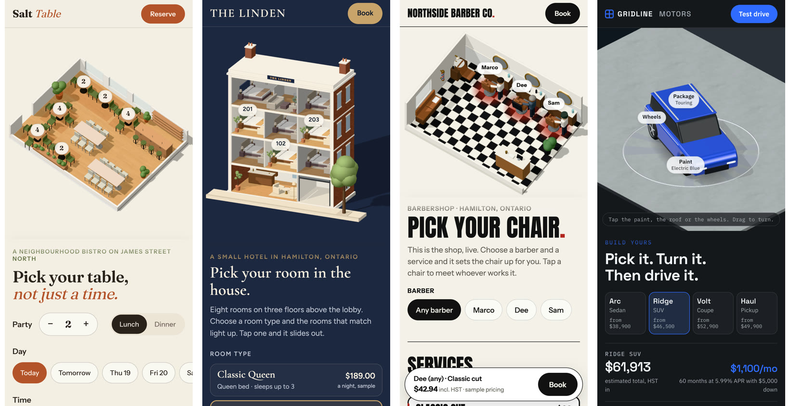
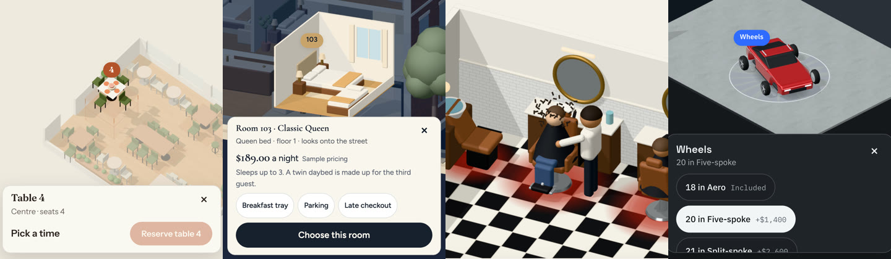
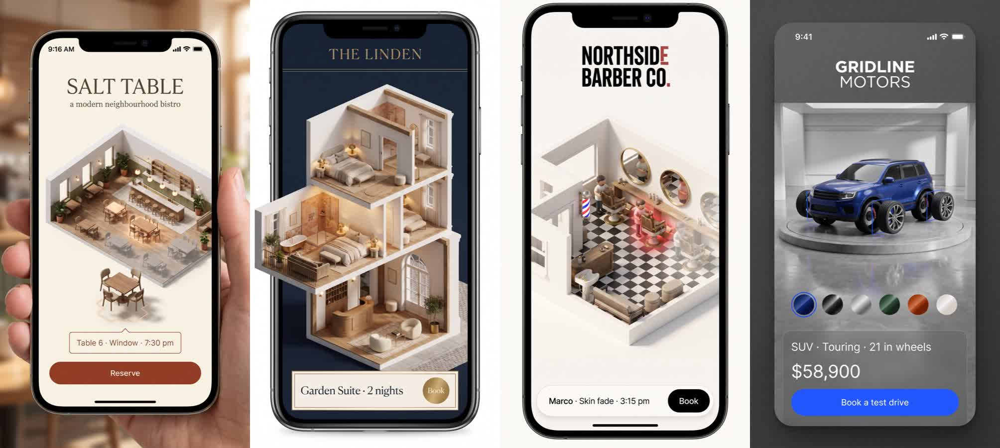

# model-craft

**An agent skill for websites whose centrepiece is an interactive 3D model of what the visitor is choosing.**

Your coding agent (Claude Code, Codex, Cursor and others) builds a site where every choice the visitor makes changes a live 3D model. Party size lights up the restaurant tables that fit. A tapped hotel room slides out of the building. The car changes body style on a turntable. The price and the booking follow along.



| Live demo | Business | What the model does |
|---|---|---|
| [Salt Table](https://salt-table-production.up.railway.app) | Restaurant | Tables that fit your party glow. Tap one and it lifts out, set for your guests (a cake for a birthday). Lunch and dinner relight the room. |
| [The Linden](https://linden-production-411171e3.up.railway.app) | Boutique hotel | The building is shown in section. Tap a room and it slides out like a drawer. Breakfast puts a tray on the bed, parking puts a car in the garage, and there is a night mode. |
| [Northside Barber Co.](https://northside-production.up.railway.app) | Barbershop | Tap a chair and the camera moves in. A service puts the cape and tools at the chair. "The cut" plays when you book. |
| [Gridline Motors](https://gridline-production-37bf1d5e.up.railway.app) | Car dealership | A procedural toy car on a turntable. Change body, paint, wheels and package. Tap the wheels and they pull out. Tap the roof and it lifts off. |

*Open the demos on your phone; they are built phone-first. All four use placeholder brands and sample prices, and their booking flows are demos (nothing is sent).*



## Why it works

The method comes from a cleaning company's booking site. There, the visitor's home was a live "dollhouse": rooms rose out of the floor as bedrooms were added, and a tapped room lifted out with its options. It took three long rounds of real client feedback to get right. The skill writes down what survived:

- **The model mirrors the choice.** It is never decoration. A choice that changes nothing visible stays in the form.
- **Procedural geometry, never generated meshes.** Image models make *pictures*: concept screens, photoreal target renders to tune the lighting against, textures and photos. The model itself is Three.js code, so it can change live.
- **Concepts first, as phone screens.** The client picks from pictures before any 3D code is written.
- **One state object, one `render()`.** The model, the form, the sheet and the price can never disagree. Every choice on the model also exists as a normal control, so keyboard, screen-reader, no-WebGL and reduced-motion visitors can still book.
- **Checked like a visitor would.** A screenshot script drives a real browser on phone and desktop. It fails the run on console errors, a model still drawing when idle, tap targets under 44 px, overlapping labels, broken keyboard selection, sideways scroll, and price text that changes between 3D on/off and motion on/off.



## Install

### Claude Code, Codex, Cursor and other agents (via [skills](https://github.com/vercel-labs/skills))

```bash
npx skills add YousifQaseer/model-craft
```

Pick your agents when asked, or pass `-a claude-code`, `-a codex`, and so on.
By default it installs into the current project (`.claude/skills/model-craft`);
add `-g` to install for your user (`~/.claude/skills/model-craft`).

### Manual

Copy `skills/model-craft` into your agent's skills folder: `~/.claude/skills/` for Claude Code, `~/.codex/skills/` for Codex. For any other agent, point it at `skills/model-craft/SKILL.md` (see [AGENTS.md](AGENTS.md)).

### Then, once

```bash
cd .claude/skills/model-craft        # or wherever it was installed (~/.claude/skills/model-craft with -g)
npm install                          # playwright-core, for the screenshot checks
node scripts/doctor.mjs              # checks Node 20+, Chrome/Chromium, ffmpeg, kie.ai
```

In a project install, add `.claude/skills/*/node_modules` to your `.gitignore`.

If you don't have Chrome, `npx playwright install chromium` gives Playwright its own copy.

## Use

Ask your agent for the site in plain words:

> Build me a website for a yoga studio where people pick a class and see the studio in 3D, with the mats filling up as they book.

> Make it like the dollhouse, but for a moving company: their rooms load into the truck and the quote updates.

The skill takes it from there:
1. It finds the model.
2. It makes concept pictures. These need an image model (kie.ai is built in,
   or use your agent's own). Without one, it shows screenshots of quick model
   variants instead.
3. It starts from the starter site.
4. It builds the model with the engine.
5. It tunes the look against a photoreal render.
6. It builds the page and the booking flow.
7. It runs the checks.

## What's inside

```
skills/model-craft/
  SKILL.md               the method, start to finish, and the hard rules
  references/            archetypes (12 business recipes), engine API, the car,
                         interaction, look, page, image prompts, lessons, verify
  engine/                the runtime (Three.js r169 vendored, ES modules, no build step)
  kit/                   room shell, tables, plants, counters... and a procedural toy car
  templates/starter/     a working little café site to copy
  scripts/               new-site, serve, shoot (checks), poster, kie (images), tex, doctor
examples/                the four demo sites above, each with a BRIEF.md
```

**Requirements:** Node 20+, plus Chrome or Chromium for the checks.
**Optional:**
- A [kie.ai](https://kie.ai) API key (`KIE_AI_API_KEY`) for generated concepts, textures and photos. Any image model works with the same prompts, and the skill also works with none.
- ffmpeg, for contact sheets and image prep.

A typical site spends about 100 to 180 kie.ai credits.

## Honest limits

- The checks run in a phone-sized desktop browser. Always try the result on a real phone before showing a client.
- It's a method, not magic. The four examples are strong first versions. A client's own feedback is what makes one great.
- Sites are static, and booking flows are click-through demos. Wire them to your own booking backend.

## License

MIT. See [LICENSE](LICENSE). Three.js (vendored in `engine/vendor/`) is MIT, © three.js authors.
